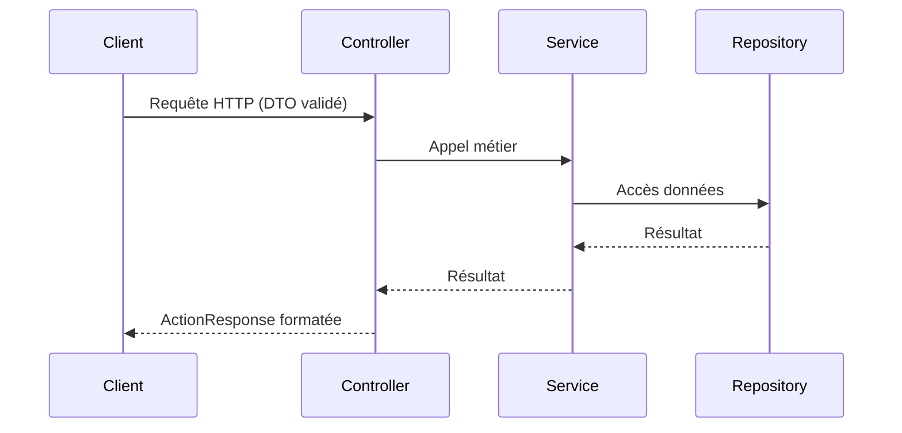

# Créer un endpoint

## Flux recommandé

Pour ajouter un nouvel endpoint en respectant l'organisation du projet :

1. **DTO** (`src/infrastructure/dto/<domaine>/`) - Définir les DTOs d'entrée/sortie avec validation et Swagger
2. **Contrôleur** (`src/api/controller/<domaine>/`) - Étendre `AbstractController`, utiliser les DTOs, déléguer au service via `this.execute()`
3. **Service** (`src/application/services/<domaine>/`) - Orchestrer la logique métier, dépendre d'interfaces/repositories
4. **Repository** (`src/infrastructure/repository/<domaine>/`) - Accès aux données via TypeORM, implémenter le contrat
5. **Entité/Relations** (`src/infrastructure/entity/`) - Mettre à jour si nécessaire, générer/appliquer une migration

## Règles à respecter

- **Contrôleur** : Pas de logique métier. Injecter le service par interface si le pattern est utilisé (`@Inject(IService)`)
- **Service** : Orchestration uniquement. Déléguer l'accès aux données aux repositories
- **Repository** : Uniquement accès aux données. Pas de logique métier
- **DTOs** : Obligatoires pour les payloads HTTP. Validés par le `ValidationPipe` global
- **Sécurité** : Utiliser `JwtAuthGuard` / `RoleGuard` + `@Roles(...)` selon les besoins
- **Documentation** : Ajouter les décorateurs Swagger (`@ApiTags`, `@ApiOperation`, `@ApiResponse`, etc.)
- **Réponses** : Passer par `AbstractController.execute()` pour uniformiser le format

## Flux simplifié

---